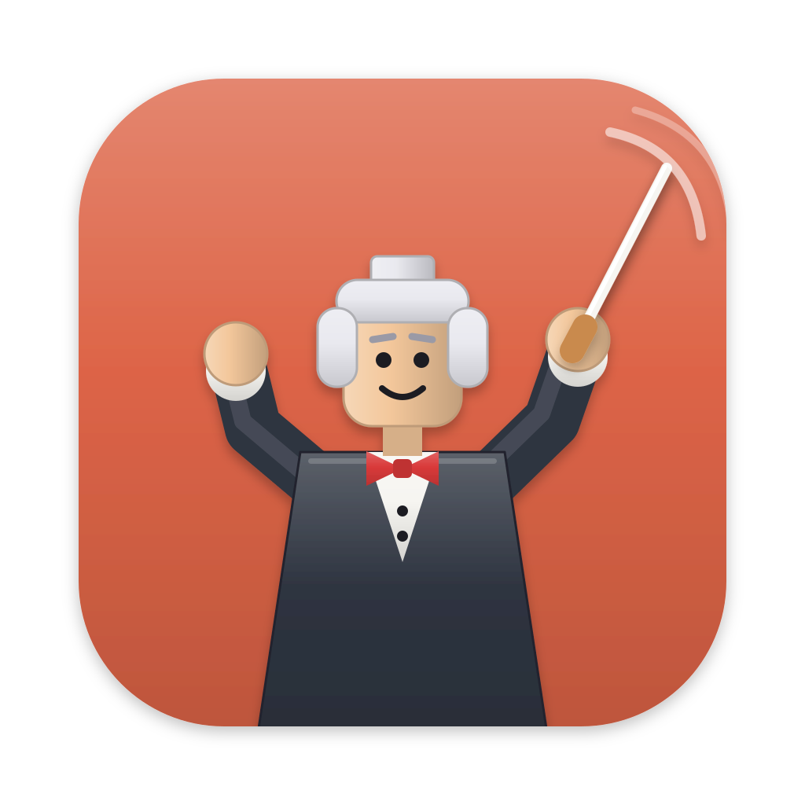
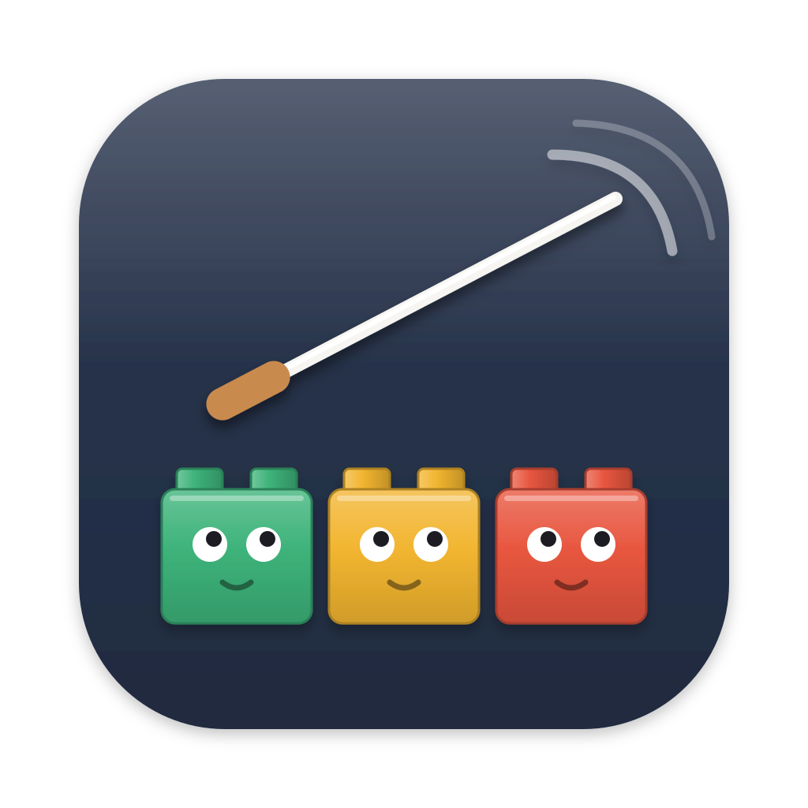
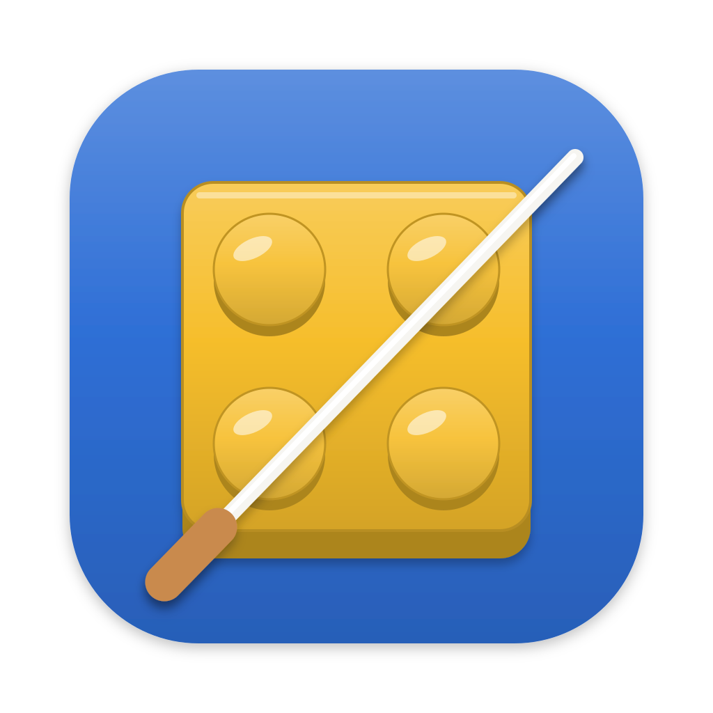
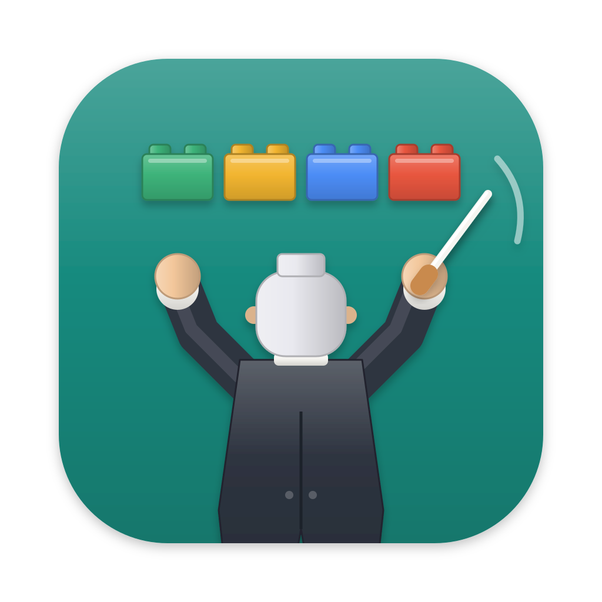
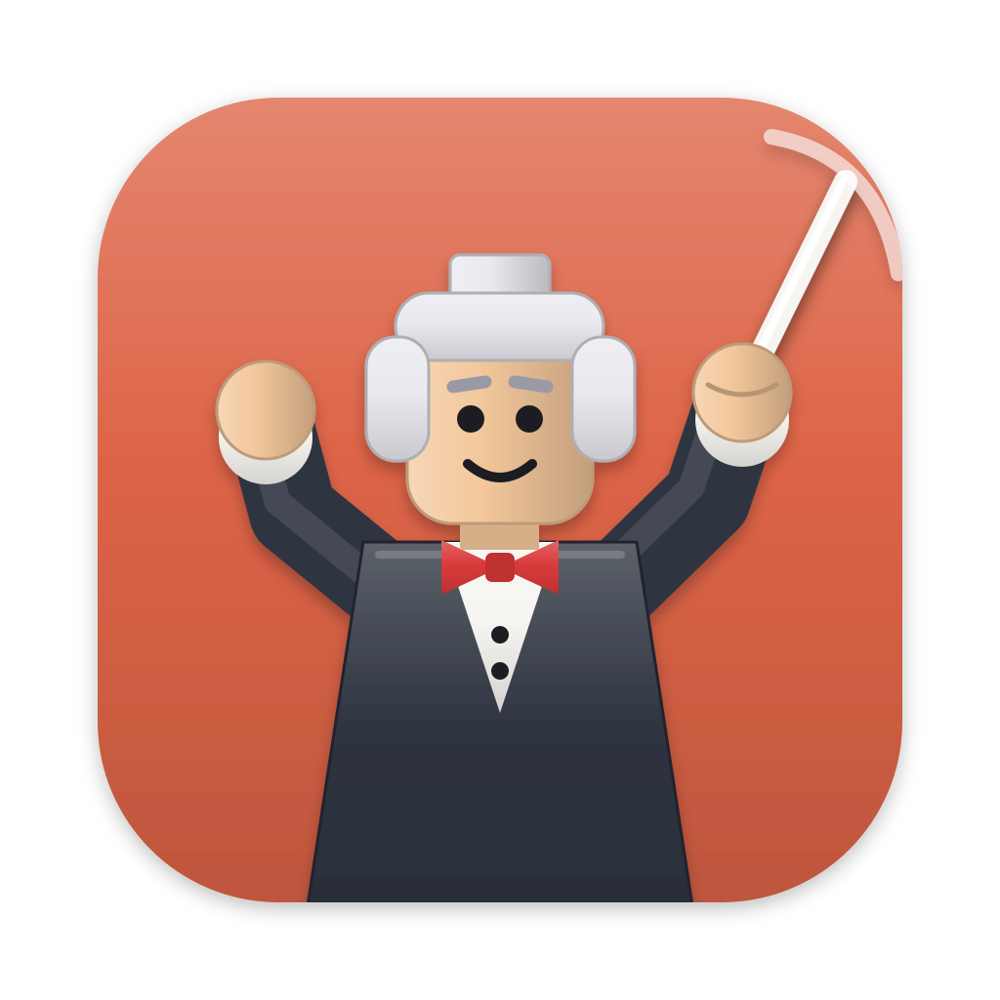
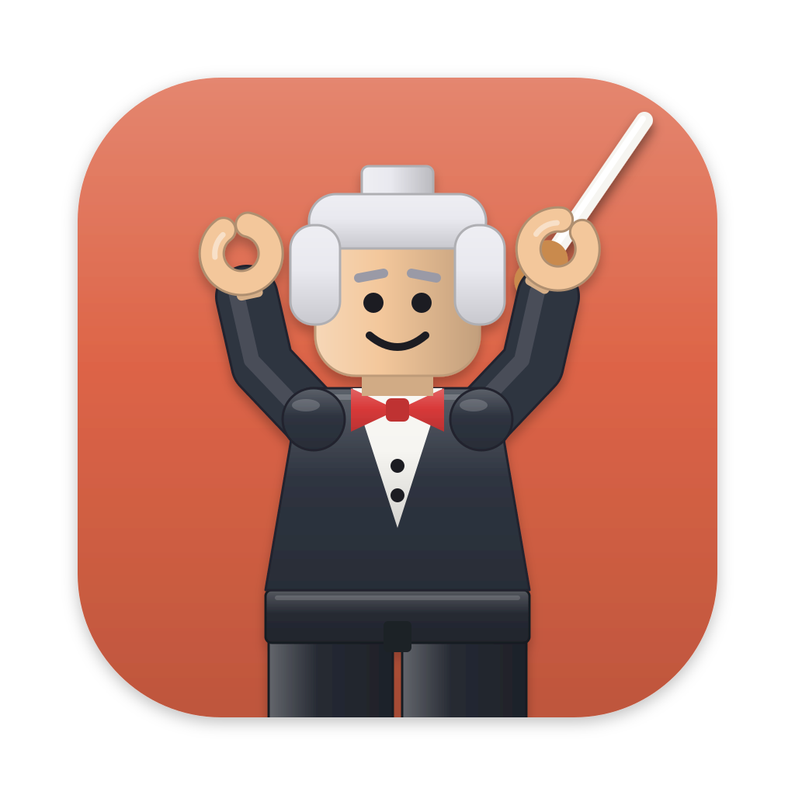
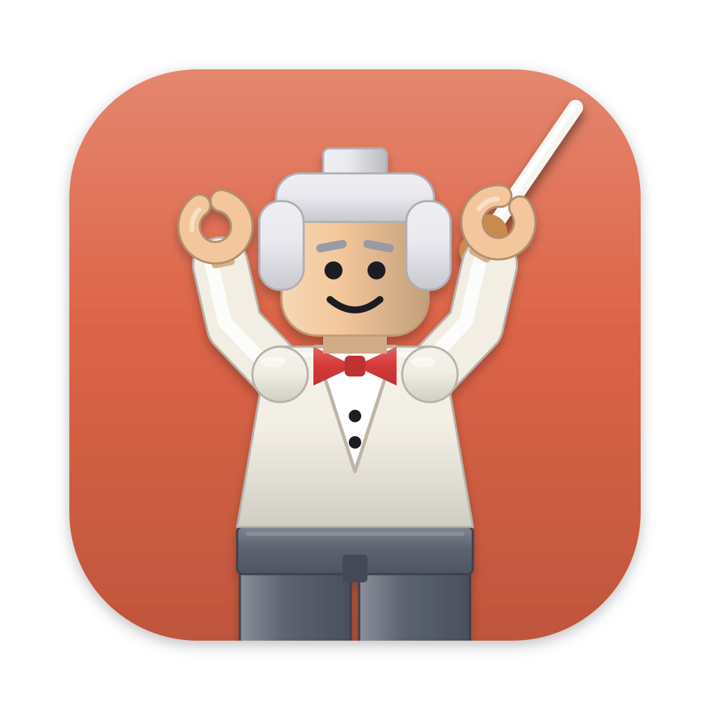
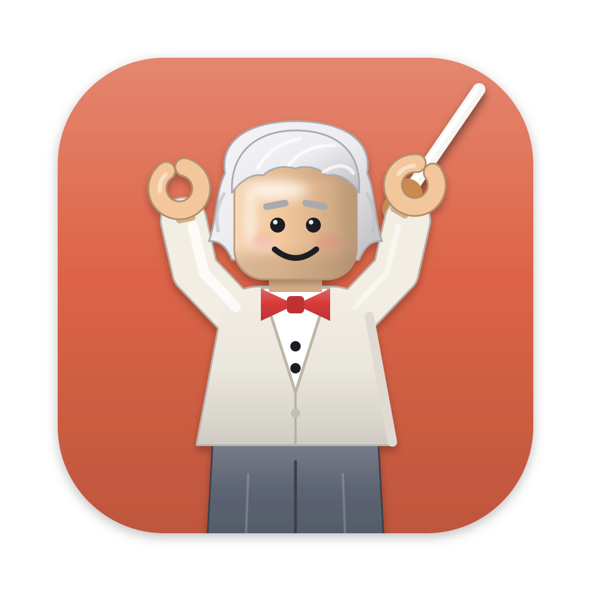
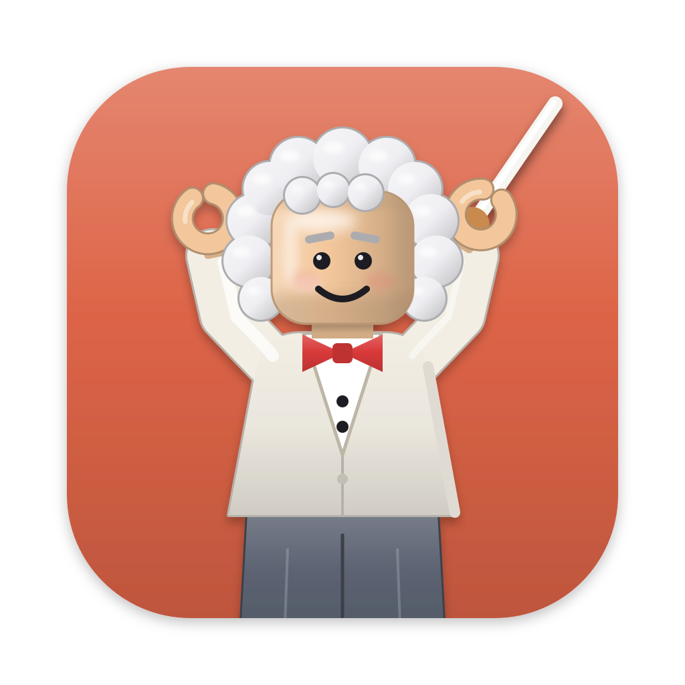
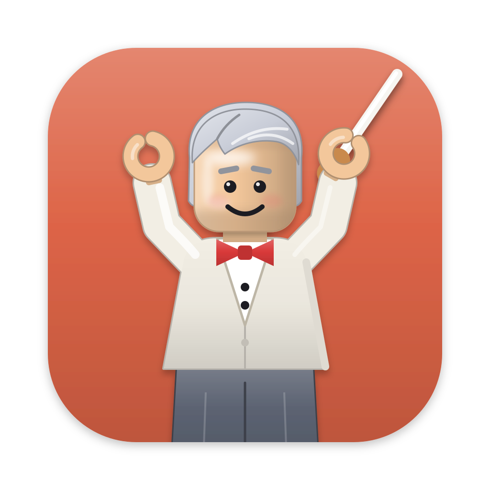

# アプリアイコン案（指揮者 × ブロック玩具風）

今のアイコン（[../AppIcon.svg](../AppIcon.svg)）は、U 字の腕と頭が抽象的すぎて指揮者に見えない。そこで、ブロック玩具のような軽い陰影（上が明るく下が暗いグラデーション、凸のスタッド、縁のハイライト線）を使った案を5つ作った。

共通の作り:

- キャンバス 1024×1024、背景の角丸は今のアイコンと同じ（x/y=100、824 角、角丸 185）
- 光は上から。面は縦グラデーション、円柱状のもの（頭・スタッド）は横グラデーション
- 指揮者のモチーフは「白髪・燕尾服・赤い蝶ネクタイ・コルク持ち手の白いタクト」でそろえた
- ブロックは「エージェント」を表す。色は一覧の状態（緑＝待機、黄＝実行中、赤＝許可待ち）に寄せた

## 一覧

| 案 | 図 | ひとことで | 小さいサイズ（16〜32px） |
|---|---|---|---|
| 1 |  | タクトを振り上げる指揮者の上半身 | 人物だとは分かる。顔やタクトは潰れる |
| 2 |  | タクトと、それを見上げる3つのブロック | 3色のブロックは残る。タクトは細くて消えがち |
| 3 |  | 2×2 のブロックの上にタクト | 一番強い。黄色い四角と斜線ではっきり見える |
| 4 |  | ブロックの楽団を率いる指揮者の後ろ姿 | 構図は残るが細部は潰れる |
| 5 |  | 目を閉じて音楽に入り込むマエストロの顔 | 顔として認識できる。表情は 32px で残る |

## 各案

### 案1: ブリック指揮者 — [01-brick-conductor.svg](01-brick-conductor.svg)

背景は今のアイコンのオレンジをそのまま使い、両手を上げてタクトを振る指揮者を正面から描いた。頭の上にスタッドがあり、玩具の人形らしさを出している。

- 良い点: 「指揮者」が一番まっすぐ伝わる。今の色を引き継ぐので見た目の連続性がある
- 気になる点: 要素が多く、Dock の小さい表示では顔とタクトが読めない

### 案2: タクトとブロックの楽団 — [02-baton-and-bricks.svg](02-baton-and-bricks.svg)

紺の背景に、目のついた3つのブロック（エージェント）が並び、上のタクトを見上げている。人物は描かず、「タクト＝自分」「ブロック＝Claude のセッション」という関係だけを描いた。

- 良い点: アプリの役割（複数のエージェントを束ねる）が一番伝わる。状態の3色がメニューバーの表示とつながる
- 気になる点: タクト単体だと指揮棒なのか菜箸なのか伝わりにくい。小さいサイズでは細い棒が消える

### 案3: ブロックとタクト — [03-top-brick-baton.svg](03-top-brick-baton.svg)

青い背景に、斜め上から見た 2×2 の黄色いブロックを置き、その上にタクトを斜めに渡した記号的な案。

- 良い点: 形が単純なので 16px でも読める。Dock に並べても目立つ
- 気になる点: 「指揮者」の要素はタクトだけで、意味は伝わりにくい。ブロック玩具そのものに寄りすぎる

### 案4: 指揮者の後ろ姿 — [04-conductor-back.svg](04-conductor-back.svg)

緑の背景に、奥に4色のブロック（楽団）が並び、手前で燕尾服の指揮者が両手を上げている。観客席から指揮者を見る構図。

- 良い点: 「指揮者が楽団を率いる」という物語が一枚で伝わる。燕尾服の裾が指揮者らしい
- 気になる点: 後ろ姿の頭（白髪＋スタッド）が何なのか分かりにくい。要素が多く、小さいと潰れる

### 案5: マエストロの顔 — [05-maestro-face.svg](05-maestro-face.svg)

黄色の背景に、白髪で目を閉じて微笑むマエストロの顔を大きく描き、右手にタクトを持たせた。キャラクターで覚えてもらう案。

- 良い点: 親しみやすく記憶に残る。顔が大きいので 32px でも表情まで見える
- 気になる点: キャラクターの印象が強く、「エージェント管理」という機能は伝わらない

## 案1のバリエーション

案1をベースにすることにしたので、細部を詰めた派生を4つ作った。4案とも次の調整は共通。

- 頭を約1.27倍、腕を 72→90、タクトを 14→24 に太くし、人物全体を大きくした（Dock の小さい表示で顔とタクトが残るように）
- タクトを手の下に通し、手がコルクの持ち手を握っているように見せた（元の案1は持ち手が手の上に乗っていた）
- タクトの軌跡は1本に絞り、太くした

| 案 | 図 | 違い |
|---|---|---|
| 1a |  | 共通の調整だけ。元の案1に一番近い |
| 1b |  | 紺の舞台にスポットライト。黒い燕尾服が光の円に浮かぶ |
| 1c |  | スタッド付きの青いブロック（指揮台）の後ろに立つ。ブロック玩具らしさが一番強い |
| 1d |  | 片手を横に広げ、目を閉じて音楽に入り込む。頭を少し傾け、音符を添えた |

- **1a** [01a-bold.svg](01a-bold.svg): 素直に読みやすくした版。迷ったらこれ
- **1b** [01b-spotlight.svg](01b-spotlight.svg): 暗いので Dock で落ち着いて見える。ダークモードのメニューバー周りとも合う。光の円は小さいサイズだとぼやけた明るい点になる
- **1c** [01c-podium.svg](01c-podium.svg): 下のブロックで「レゴのような」感じがはっきり出る。その分、人物が上に寄って少し窮屈
- **1d** [01d-rapture.svg](01d-rapture.svg): 一番表情があって楽しい。ただし左右の形が非対称になり、32px では左手と音符が細かい点に見える

## 案1a の詰め

1a を採ることにして、次の点を直した。

| 版 | 図 | 内容 |
|---|---|---|
| v2 |  | タクトの軌跡の線を外した。腕を玩具の人形が万歳した形（丸い肩の関節、C 字の手、タクトは右手の C に通す）にした。胴を短くして腰と脚の付け根を描き、頭身を下げた |
| v3 |  | v2 の黒い燕尾服はコントラストが強すぎたので、服を白（少し暖かい白）に、ズボンをグレーにした。シャツの V はグレーの縁取りで見分ける |

| v4 |  | 実物の人形の写真に寄せた試作。腕を真上に上げ、髪は後ろだけ。頭が大きく腕が窮屈になり不採用（黄色い頭の版 [01a-v4-yellow.svg](01a-v4-yellow.svg) もある） |
| v5 |  | v3 の構成のまま描き直した版。腕は肘を曲げず肩からまっすぐ外上へ、頭は円柱、髪キャップの上に中空のスタッド。左にハイライト・右に陰を入れたプラスチックの陰影と、首の下・胴の下・腕の付け根の影を足した |

| v6 |  | v5 はやめて v3 に戻した。肩の丸を外し、なで肩の胴と腕を同じ輪郭でつないだ。ズボンは腰のパーツと脚のブロックをやめて1枚の形にし、中央の線で脚を表した |

- [01a-v2.svg](01a-v2.svg)
- [01a-v3.svg](01a-v3.svg)
- [01a-v5.svg](01a-v5.svg)
- [01a-v6.svg](01a-v6.svg)

### v7: 髪型3案と顔の立体感

v6 をもとに髪型を3方向で作り、顔の陰影は3案共通で足した。普通の髪型の上にスタッドが乗ると不自然なので、スタッドは外した。

- 顔: 額と左頬に柔らかいハイライト、髪の生え際に薄い影、あごと右側に向けて少し暗く、頬にほんのり赤み、目に小さな光

| 版 | 図 | 髪型 |
|---|---|---|
| v7a |  | 後ろへ流すオールバックの白髪。襟足が左右に少し跳ねる |
| v7b |  | ふわふわの白髪。丸い房で頭を囲む（古典派の作曲家・指揮者風） |
| v7c |  | 横分けの銀髪。すっきりして若めの印象 |

### 採用: v7b

v7b を採用し、次の2点を変えて [../AppIcon.svg](../AppIcon.svg) に置いた（2026-11-04）。

- 背景のオレンジが濁って見えたので、Claude のアイコンの色 `#E55532` に合わせ、上下の明暗の差も弱くした（元は `#DD6447` で、下側を暗くしていたため Dock では `#D55A40` に見えていた）
- 眉を外した

## 組み合わせの候補

- **案3の単純さ ＋ 案2の意味**: ブロックのスタッドを3色にしてタクトを渡すと、小さくても読めて、状態の色ともつながる
- **案5の顔 ＋ 案2のブロック**: マエストロの顔の下にブロックを1列並べる。ただし要素が増えるので小さいサイズの確認が必要

## 採用したら

採用した SVG を [../AppIcon.svg](../AppIcon.svg) に上書きし、`./Scripts/make-appicon.sh` で `App/Assets.xcassets` に書き出す。
