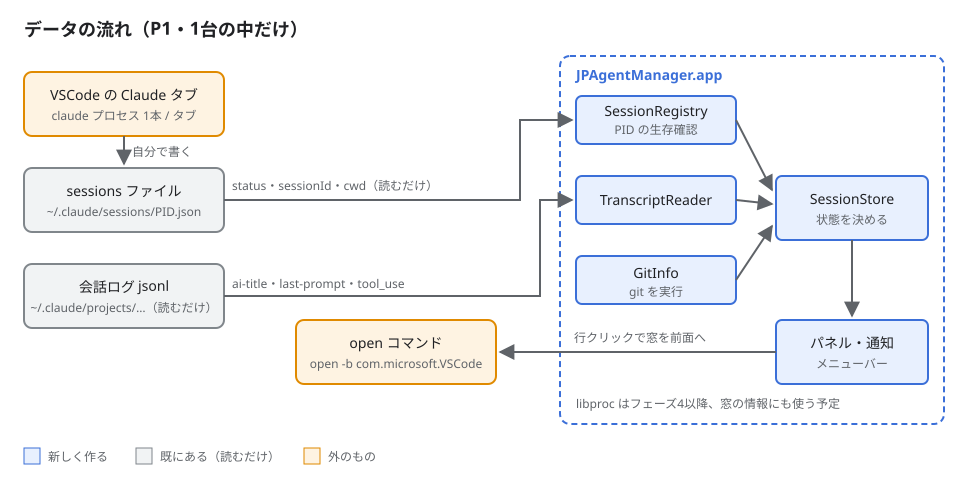
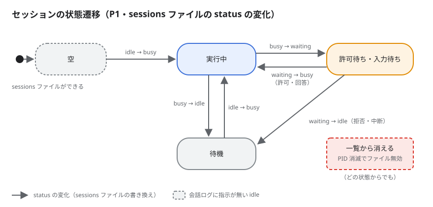
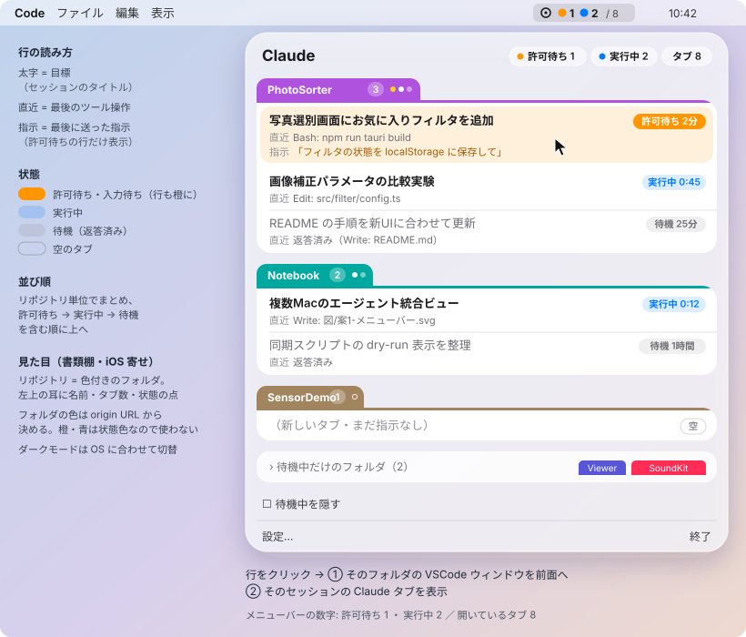
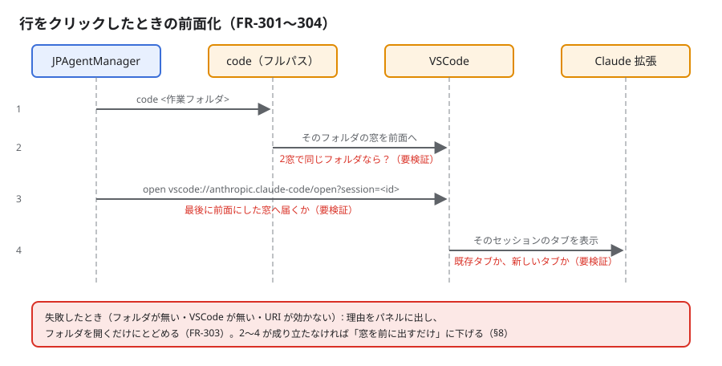

# 実装計画-P1（1台で完結）

## 変更履歴

| 日付 | 変更者 | 変更内容 |
| --- | --- | --- |
| 2026-10-30 | Claude | フェーズ4（前面化は窓まで・通知・5分の強調）を実装しレビュー指摘を反映。P1-7 で要求仕様を 0.2 に更新 |
| 2026-10-30 | Claude | P1-4 の結果（URI は新しいタブを作る）から、前面化を窓までに下げた（ユーザー決定）。フェーズ2・3を完了にした |
| 2026-10-30 | Claude | P2-5・P3-7・P3-8 を実装しレビュー指摘を反映（テスト通過）。P1-5 の見た目確認は本番アプリで行う。窓の情報（P3-4）はフェーズ4で使う |
| 2026-10-30 | Claude | 状態の取得元をフックから ~/.claude/sessions/<PID>.json（読むだけ）に変更。P3-1〜P3-3・P5-3 を取りやめ、P3-9 を追加 |
| 2026-10-30 | Claude | P3-1 をシェルスクリプトから Swift の補助プログラムに変更（行の混入と大きな入力での遅さを解消するため）。settings.json はキー順で書く |
| 2026-10-30 | Claude | 波1・波2を実装しレビュー指摘を反映（テスト72件が通過）。フックのスクリプトは大きな入力で 50ms を超えるため方式を再検討 |
| 2026-10-30 | Claude | 並列実行の割り振りを追加し、P2-1 の依存を外した（対応 OS は macOS 26 で確定済みのため） |
| 2026-10-30 | Claude | 初版作成。検証を先に置き、P1 を5フェーズに分けた |

## 目次

- [概要](#概要) / [進捗](#進捗)
- [フェーズ1: 不明点の検証](#フェーズ1-不明点の検証)
- [フェーズ2: 雛形と画面（サンプルデータ）](#フェーズ2-雛形と画面サンプルデータ)
- [フェーズ3: 実データで一覧](#フェーズ3-実データで一覧)
- [フェーズ4: 前面化と通知](#フェーズ4-前面化と通知)
- [フェーズ5: 仕上げ](#フェーズ5-仕上げ)
- [全体の完了基準](#全体の完了基準) / [注意点](#注意点) / [ディレクトリ構成](#ディレクトリ構成)

## 概要

要求仕様の P1（ローカルのセッションの一覧・状態・通知・前面化）を、書類棚デザインのメニューバーアプリとして作る。状態の判定と前面化には実機で確かめないと分からない点があるので、フェーズ1で先に検証し、結果で要求仕様を直してから作り始める。

- **対象**: macOS 26 以上のメニューバー常駐アプリ（SwiftUI＋AppKit、XcodeGen でプロジェクト生成）と、Claude Code のフックのスクリプト
- **やらないこと**: P2（マシン横断・Tailscale・origin URL でのまとめ）、CLI セッションの前面化、App Store 配布・公証
- **関連**: [要求仕様.md](要求仕様.md)、[設計メモ.md](設計メモ.md)、画面 [図/案1-メニューバー.svg](図/案1-メニューバー.svg)

**図**:



アプリは「Claude Code のセッションファイル（~/.claude/sessions/）」「プロセス一覧」「会話ログ」「git」の4つを読むだけで、どこにも書き込まない。

## 進捗

**現在**: フェーズ4の目視確認待ち。次はフェーズ5（仕上げ）

| フェーズ | 状態 | 完了 | 備考 |
| --- | --- | --- | --- |
| 1. 不明点の検証 | ✅ 完了 | 7/7 | 要求仕様 0.2・設計メモ・図に反映済み |
| 2. 雛形と画面（サンプルデータ） | ✅ 完了 | 6/6 | 目視はユーザー確認済み（ライト） |
| 3. 実データで一覧 | ✅ 完了 | 9/9 | 実機で一覧の表示を確認 |
| 4. 前面化と通知 | 🔄 進行中 | 4/4 | 実機での目視確認待ち |
| 5. 仕上げ | ⬜ 未着手 | 1/5 | P5-3 は取りやめ |

> 状態: ⬜ 未着手 / 🔄 進行中 / ✅ 完了 / ⏸️ 保留。タスクは `- [ ]` / `- [x]`。
> フェーズ内の全タスクが `- [x]` になったら ✅ にする。備考は1行まで（詳細は各フェーズ本文へ）。
> タスクの「触る」は書き換えるファイルを全部（宣言・登録・索引への追記も含む）、「依存」は先に終わっている必要があるタスク ID。

### 更新のきまり

- 更新は実装したターン内で行う（「動いた＝更新済み」と錯覚しない）
- **状態はこの表だけに書く**。フェーズ見出しには書かない
- 変更履歴は**新しい行を上に**足す。1行1文
- 計画とズレたら計画側を直し、変更履歴に残す

---

## フェーズ1: 不明点の検証

**目標**: 状態の判定・前面化・メニューバー表示の不明点に答えが出て、要求仕様と設計メモに反映されている。

検証は使い捨てのリポジトリ `~/Documents/Project/_jpam-spike/`（このリポジトリの外）で行う。フックはそのリポジトリの `.claude/settings.local.json` にだけ登録し、`~/.claude/settings.json` には触らない。

**図**:



赤い破線の遷移が検証の対象。結果に合わせてこの図と要求仕様 §4.2 を直す。

### タスク

- [x] **P1-1**: 検証用リポジトリを作り、全フック（SessionStart / UserPromptSubmit / PreToolUse / PostToolUse / Notification / Stop / SessionEnd）の入力と親プロセスの連なりを1行ずつ記録するスクリプトを置く（触る: `Spike/record-hook.sh`, `Spike/README.md`／依存: なし）
- [x] **P1-2**: 状態の場面を順に再現して記録を読む。許可待ち→許可、許可待ち→拒否、Esc で中断、60秒放置、タブを閉じる、新しいタブ（触る: `Docs/設計メモ.md`／依存: P1-1）（結果: 許可待ちは Notification の permission_prompt、許可後は PostToolUse→Stop、拒否後はフックが何も来ない、60秒放置は通知なし。拒否が取れないため取得元を sessions ファイルへ変更）
- [x] **P1-3**: フックから `claude` プロセスの PID がたどれるか、フックの実行時間が 50ms 以内に収まるかを測る（触る: `Spike/record-hook.sh`, `Docs/設計メモ.md`／依存: P1-1）（結果: bash→claude→Code Helper (Plugin) とたどれた。スクリプトは平均32〜42ms。フックは取りやめ）
- [x] **P1-4**: 前面化を手で試す。`code` をフルパスで呼んだとき既存の窓が前に出るか、URI がどの窓に届くか、既存タブを開くか、同じフォルダを2窓で開いたときどうなるか（触る: `Docs/設計メモ.md`／依存: なし）（結果: code のフルパスで窓は前に出る。URI は既存タブを表示せず、同じ会話の新しいタブを作り「別の場所でも開いている」警告が出る。§8 の2が不成立のため、前面化は窓までに下げる）
- [x] **P1-5**: メニューバーの試作を `swiftc` で作る。`NSStatusItem` にカラーの点が出るか、`NSPanel` に `.glassEffect` が効くか、中身に合わせて高さが変わるか、行のクリックや外側のクリックで閉じるか（触る: `Spike/MenuBarSpike/main.swift`／依存: なし）（結果: 本番アプリで確認。カラーの点・ガラス・高さの追従・開閉が動く。中身の高さを測る仕組みは onGeometryChange に直した）
- [x] **P1-6**: libproc（`proc_listpids` / `proc_pidinfo`）で `claude` プロセスと作業フォルダを2秒ごとに取り、CPU 使用率を測る（触る: `Spike/ProcScan/main.swift`／依存: なし）
- [x] **P1-7**: 結果を反映する。要求仕様 §4.2 の判定表・§8・NFR-06（macOS 26 以上）を直し、状態遷移の図の赤い破線を確定させる（触る: `Docs/要求仕様.md`, `Docs/設計メモ.md`, `Docs/図/計画-P1-状態遷移.svg`／依存: P1-2〜P1-6）

### 完了確認

```bash
grep -n "## 検証結果" Docs/設計メモ.md
# 期待: 1件。その下に P1-2〜P1-6 の項目がそれぞれある
grep -n "macOS 26" Docs/要求仕様.md
# 期待: NFR-06 の行が出る
```

- [ ] 検証結果を読んで、フェーズ2以降の方針（パネル方式・状態判定に足すフック）に合意した（目視）

---

## フェーズ2: 雛形と画面（サンプルデータ）

**目標**: アプリが起動し、メニューバーの点とパネルが書類棚デザインでサンプルデータを表示する。

**画面**:



フォルダの耳は左揃え。許可待ちの行だけ橙に塗り、カプセルも許可待ちだけ塗りつぶす。

### タスク

- [x] **P2-1**: `project.yml`（アプリ＋テストの2ターゲット）と最小のアプリ（`LSUIElement`、Dock に出さない）を作る。`.xcodeproj` は `.gitignore` に入れる。xcodegen は導入済み（2.45.3）（触る: `project.yml`, `App/JPAgentManagerApp.swift`, `App/Info.plist`, `Tests/SmokeTests.swift`, `.gitignore`／依存: なし）
- [x] **P2-2**: モデルとサンプルデータ（Repo / Session / 状態の enum、画面図と同じ内容）（触る: `App/Model/Session.swift`, `App/Model/SampleData.swift`／依存: P2-1）
- [x] **P2-3**: 色の定義。状態の色、リポジトリの色（パスのハッシュで紫・ミント・ブラウンなどから選び、橙・青は使わない）、ライト／ダーク（触る: `App/Views/Theme.swift`／依存: P2-1）
- [x] **P2-4**: 画面の部品。フォルダ（耳つきの形）・セッションの行・状態カプセル・折りたたみ行（触る: `App/Views/ShelfView.swift`, `App/Views/FolderView.swift`, `App/Views/SessionRow.swift`, `App/Views/StatusCapsule.swift`／依存: P2-2, P2-3）
- [x] **P2-5**: メニューバーの点（カラー画像）とパネルの表示・非表示。方式はフェーズ1の P1-5 の結果に従う（触る: `App/StatusItemController.swift`, `App/PanelController.swift`, `App/JPAgentManagerApp.swift`／依存: P2-4）
- [x] **P2-6**: 並び順（許可待ちを含むリポジトリ → 実行中 → 待機、リポジトリ内も同じ）を関数にしてテストする（触る: `App/Model/Sorting.swift`, `Tests/SortingTests.swift`／依存: P2-2）

### 完了確認

```bash
xcodegen generate && xcodebuild -scheme JPAgentManager -destination 'platform=macOS' build test 2>&1 | tail -3
# 期待: ** BUILD SUCCEEDED ** と ** TEST SUCCEEDED **
```

- [ ] 画面イメージと同じ配置になる。ライトとダークの両方で読める（目視）

---

## フェーズ3: 実データで一覧

**目標**: 実際に開いている Claude Code のタブが、正しい状態で2秒以内に一覧へ出て、閉じたら10秒以内に消える。

### タスク

- [x] **P3-1**: フックの補助プログラム（Swift のコマンドラインツール `jpam-hook`）。stdin の JSON から状態の判定に要る項目だけを取り出し、時刻と `claude` の PID（libproc で親をたどる）を足して `~/Library/Application Support/JPAgentManager/events.jsonl` にロックを取って1行で追記する。必ず終了コード 0 で返し、大きな入力でも 50ms 以内（触る: `project.yml`, `HookHelper/main.swift`, `Hooks/jpam-hook.sh`（削除）, `App/Setup/HookInstaller.swift`, `Tests/HookInstallerTests.swift`, `Tests/HookHelperTests.swift`／依存: なし）（取りやめ: 状態を sessions ファイルから取るため。コードは HookHelper/ に残す）
- [x] **P3-2**: フックの登録と解除。`~/.claude/settings.json` を退避してから、既存の設定を消さずに追記する。実行前に了承のダイアログを出す（触る: `App/Setup/HookInstaller.swift`, `Tests/HookInstallerTests.swift`／依存: P3-1）（取りやめ: 同上。settings.json は書き換えない。コードは残す）
- [x] **P3-3**: events.jsonl の末尾だけを読み、変化を監視する（触る: `App/Sources/HookEventReader.swift`／依存: P2-2）（取りやめ: 同上。コードは残す）
- [x] **P3-4**: libproc で `claude` プロセスを数え、PID と作業フォルダを取る（触る: `App/Sources/ProcessScanner.swift`／依存: P2-2）
- [x] **P3-5**: 会話ログの末尾から ai-title・last-prompt・最後の tool_use を読み、`Edit: src/a.ts` の形に整える。読めない項目は「—」（触る: `App/Sources/TranscriptReader.swift`, `Tests/TranscriptReaderTests.swift`, `Tests/Fixtures/sample-transcript.jsonl`, `Tests/GitInfoTests.swift`／依存: P2-2）
- [x] **P3-6**: 作業フォルダから git のルートとブランチを取り、キャッシュする（触る: `App/Sources/GitInfo.swift`／依存: P2-2）
- [x] **P3-7**: SessionStore。sessions ファイル（P3-9）を主に、プロセス（P3-4）で生存と窓を、会話ログ（P3-5）で目標・直近・指示を、git（P3-6）でリポジトリを補い、状態を決めてリポジトリごとにまとめる。状態の対応: busy→実行中、waiting→許可待ち・入力待ち、idle→待機（会話ログに指示が無ければ空）（触る: `App/Model/SessionStore.swift`, `Tests/SessionStoreTests.swift`／依存: P3-4〜P3-6, P3-9）
- [x] **P3-8**: パネルをサンプルデータから SessionStore に差し替える（触る: `App/JPAgentManagerApp.swift`, `App/Views/ShelfView.swift`／依存: P3-7）
- [x] **P3-9**: `~/.claude/sessions/<PID>.json`（pid・sessionId・cwd・entrypoint・status・waitingFor・statusUpdatedAt）を読む。変化を監視し、PID が生きているもの（procStart で再利用を見分ける）だけを返す。会話ログの場所は sessionId から組み立て、無ければ projects 配下を探す。形式が読めなければ「状態不明」（触る: `App/Sources/SessionRegistry.swift`, `Tests/SessionRegistryTests.swift`, `Tests/Fixtures/sessions/`／依存: なし）

### 完了確認

```bash
xcodebuild -scheme JPAgentManager -destination 'platform=macOS' test 2>&1 | tail -1
# 期待: ** TEST SUCCEEDED **（状態遷移・ログ解析・フック登録のテストを含む）
```

- [ ] 新しいタブ → 空、指示 → 実行中、許可の要求 → 許可待ち、返答 → 待機、の順に2秒以内に変わる（目視）
- [ ] タブを閉じると10秒以内に消える（目視）

---

## フェーズ4: 前面化と通知

**目標**: 行のクリックでそのセッションのタブが前に出て、許可待ちになると通知が来る。

**図**:



1 と 3 の間で窓が前に出きってから URI を送る。失敗したら理由を出してフォルダを開くだけにする。

### タスク

- [x] **P4-1**: 前面化。VSCode に入っている `code` をフルパスで呼び、そのセッションの作業フォルダの窓を前に出す（URI でのタブ表示はしない。P1-4 の結果）。VSCode 拡張のセッション（entrypoint が claude-vscode）以外は前面化せず理由を出す。失敗の理由の表示（FR-301・FR-303）（触る: `App/Actions/Focuser.swift`, `Tests/FocuserTests.swift`, `App/Model/Session.swift`, `App/Model/SessionStore.swift`／依存: P3-8）
- [x] **P4-2**: 行のクリックで前面化してパネルを閉じる（触る: `App/Views/SessionRow.swift`, `App/PanelController.swift`／依存: P4-1）
- [x] **P4-3**: 許可待ちになったら通知を出し、通知のクリックで前面化する。完了の通知は設定で ON/OFF（既定 OFF）（FR-202, FR-203）（触る: `App/Actions/Notifier.swift`, `App/Model/SessionStore.swift`／依存: P4-1）
- [x] **P4-4**: 許可待ちが5分続いたら、メニューバーのアイコンを強調する（FR-204）（触る: `App/StatusItemController.swift`／依存: P3-8）

### 完了確認

```bash
xcodebuild -scheme JPAgentManager -destination 'platform=macOS' test 2>&1 | tail -1
# 期待: ** TEST SUCCEEDED **
```

- [ ] 別の窓の裏にあるタブの行をクリックすると、その窓とタブが前に出る（目視）
- [ ] 許可待ちの通知が来て、クリックで前面化する（目視）

---

## フェーズ5: 仕上げ

**目標**: 毎日使える状態になる（折りたたみ・設定・ログイン時の起動・負荷の確認）。

### タスク

- [ ] **P5-1**: 待機だけのフォルダを折りたたみ、「待機中を隠す」を付ける（FR-107）（触る: `App/Views/ShelfView.swift`, `App/Model/Settings.swift`／依存: P3-8）
- [ ] **P5-2**: 設定画面。通知の ON/OFF、フックの登録状態と解除、ログイン時に起動（`SMAppService`）（触る: `App/Views/SettingsView.swift`, `App/Model/Settings.swift`, `App/JPAgentManagerApp.swift`／依存: P5-1, P3-2）
- [x] **P5-3**: アプリより前から開いていたタブを、作業フォルダが同じで最近更新されたログに当てて補う（§8 の5）（触る: `App/Model/SessionStore.swift`, `Tests/SessionStoreTests.swift`／依存: P3-7）（取りやめ: sessions ファイルには起動前から開いていたタブも載っているため）
- [ ] **P5-4**: 負荷を測る。待機中の CPU が平均1%未満、フックが 50ms 以内（NFR-01, 02）（触る: `Docs/設計メモ.md`／依存: P5-1〜P5-3）
- [ ] **P5-5**: README の状態と使い方を書き換え、要求仕様の版を上げる（触る: `README.md`, `Docs/要求仕様.md`／依存: P5-4）

### 完了確認

```bash
xcodebuild -scheme JPAgentManager -destination 'platform=macOS' test 2>&1 | tail -1
# 期待: ** TEST SUCCEEDED **
top -l 30 -s 2 -stats command,cpu | grep JPAgentManager | awk '{s+=$2;n++} END {print s/n}'
# 期待: 1.0 未満
```

- [ ] ログアウト→ログインで自動で起動する（目視）

---

## 全体の完了基準

- [ ] FR-101〜109、FR-201〜204、FR-301〜303 を満たす（FR-304 はフェーズ1の結果次第で対象外）
- [ ] 全テストが通り、NFR-01〜07 を測って設計メモに記録してある
- [ ] `~/.claude/` で書き換えたのはフックの登録だけで、解除すると元に戻る

## 注意点

- 状態は `~/.claude/sessions/<PID>.json` から取る。`ai-title` と同じく公開仕様ではないので、読めなければ「状態不明」を出して落ちない。waitingFor は実測で "permission prompt" と "input needed" を確認（2026-10-30, v2.1.311）
- `code` コマンドは PATH に無い（この Mac で確認）。`/Applications/Visual Studio Code.app/Contents/Resources/app/bin/code` を使う
- `ai-title` と `last-prompt` は公開仕様ではない。読めなければ「—」を出し、落ちないことをテストで守る
- SwiftUI の `MenuBarExtra` は、メニューバーの画像が白黒になり、パネルを閉じる API もない。フェーズ1の結果で `NSStatusItem`＋`NSPanel` に切り替える見込み

## ディレクトリ構成

```
JPAgentManager/
├── project.yml            # XcodeGen（.xcodeproj は生成物で git 管理しない）
├── App/
│   ├── JPAgentManagerApp.swift, StatusItemController.swift, PanelController.swift, Info.plist
│   ├── Model/             # Session, SessionStore, Sorting, Settings, SampleData
│   ├── Sources/           # HookEventReader, ProcessScanner, TranscriptReader, GitInfo
│   ├── Actions/           # Focuser, Notifier
│   ├── Setup/             # HookInstaller
│   └── Views/             # Theme, ShelfView, FolderView, SessionRow, StatusCapsule, SettingsView
├── Hooks/jpam-hook.sh
├── Spike/                 # フェーズ1の検証用（製品には入れない）
├── Tests/
└── Docs/
```

## 並列実行の割り振り

人が VSCode を操作しないと確かめられない検証（P1-2・P1-4・P1-5 の見た目）は、波2のあとにまとめてユーザーに頼む。それまでは、検証の結果に左右されない部分を先に進める。

| 波 | レーン | タスク | 書き込み先 |
| --- | --- | --- | --- |
| 1 | A | P1-1（＋P1-3 のうち実行時間の計測） | `Spike/record-hook.sh`, `Spike/README.md`, リポジトリ外 `~/Documents/Project/_jpam-spike/` |
| 1 | B | P1-5（試作のビルドまで） | `Spike/MenuBarSpike/` |
| 1 | C | P1-6 | `Spike/ProcScan/` |
| 1 | D | P2-1 | `project.yml`, `App/JPAgentManagerApp.swift`, `App/Info.plist`, `Tests/SmokeTests.swift`, `.gitignore` |
| 1 | E | P2-2, P2-3（先行: モデルの型） | `App/Model/Session.swift`, `App/Model/SampleData.swift`, `App/Views/Theme.swift` |
| 2 | A | P2-4 | `App/Views/ShelfView.swift`, `FolderView.swift`, `SessionRow.swift`, `StatusCapsule.swift` |
| 2 | B | P2-6 | `App/Model/Sorting.swift`, `Tests/SortingTests.swift` |
| 2 | C | P3-5, P3-6 | `App/Sources/TranscriptReader.swift`, `GitInfo.swift`, `Tests/TranscriptReaderTests.swift`, `Tests/Fixtures/` |
| 2 | D | P3-3, P3-4 | `App/Sources/HookEventReader.swift`, `ProcessScanner.swift`, `Tests/HookEventReaderTests.swift` |
| 2 | E | P3-1, P3-2 | `Hooks/jpam-hook.sh`, `App/Setup/HookInstaller.swift`, `Tests/HookInstallerTests.swift` |
| — | ユーザー | P1-2, P1-3, P1-4, P1-5 の目視 | `Spike/README.md` の手順で操作し、結果を伝える |
| 3以降 | — | P1-7 → P2-5, P3-7, P3-8 → フェーズ4・5 | 検証結果を見てから割り振る |
