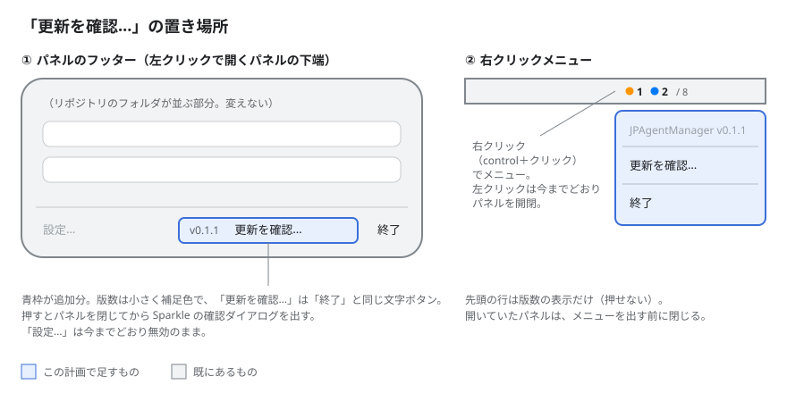

# 実装計画-自動更新

## 変更履歴

| 日付 | 変更者 | 変更内容 |
| --- | --- | --- |
| 2026-11-04 | Claude | P3-6 を追加: JPScreenShot に倣い package.json（NPM SCRIPTS）を置いた（当初は作らない方針だったがユーザーの指示で変更） |
| 2026-11-04 | Claude | レビューを反映: ハードンドランタイムを CI のコマンドライン指定に移し、Sparkle を 2.9.3 に固定、Debug の自動確認はデリゲートで止める形にした |
| 2026-11-04 | Claude | フェーズ1〜3 を1波・5レーンで実装し、ビルドとテスト（160件）が通った |
| 2026-11-04 | Claude | 初版作成。Sparkle の組み込み・更新の入口・リリースの仕組み・初回リリースを4フェーズに分けた |

## 概要

Sparkle でアプリ内の自動更新を入れ、手動の「更新を確認…」をパネルのフッターと右クリックメニューの両方に置く。配布は GitHub Release（Developer ID 署名＋公証の zip）、更新情報（appcast）は GitHub Pages に置く。作りは JPScreenShot（`../JPScreenShot`）の `release.yml`・`Tools/release.sh`・`ExportOptions.plist`・`UpdaterController.swift`・`Docs/リリース手順.md` に倣う。

- **対象**: Sparkle の組み込み、更新の入口（フッター・右クリックメニュー）、リリース用の CI・スクリプト・手順書、初回リリース
- **やらないこと**: ランディングページ（GitHub Pages には appcast だけ置く）、設定画面（自動確認の切り替えなど）、開発ビルドの署名の変更
- **決定事項**: Sparkle の鍵は JPAgentManager 専用に新しく作る／`jpam-hook` はアプリに同梱しない（ターゲットとソースは残す）／ハードンドランタイムは CI のアーカイブだけ有効（コマンドラインで `ENABLE_HARDENED_RUNTIME=YES` を渡す）
- **関連**: [要求仕様.md](要求仕様.md)、[実装計画-P1.md](実装計画-P1.md)、JPScreenShot の `Docs/リリース手順.md`

## 進捗

**現在**: フェーズ2 の目視確認と、フェーズ4（次の一手: P4-1 GitHub Secrets の登録）

| フェーズ | 状態 | 完了 | 備考 |
| --- | --- | --- | --- |
| 1. Sparkle の組み込み | ✅ 完了 | 4/4 | 公開鍵は OSZaKH… |
| 2. 更新の入口 | 🔄 進行中 | 5/5 | 実機での目視確認待ち |
| 3. リリースの仕組み | ✅ 完了 | 6/6 | — |
| 4. 初回リリース | ⬜ 未着手 | 0/4 | 外部への操作を含むのでユーザーと一緒に行う |

> 状態: ⬜ 未着手 / 🔄 進行中 / ✅ 完了 / ⏸️ 保留。タスクは `- [ ]` / `- [x]`。
> フェーズ内の全タスクが `- [x]` になったら ✅ にする。備考は1行まで（詳細は各フェーズ本文へ）。
> タスクの「触る」は書き換えるファイルを全部（宣言・登録・索引への追記も含む）、「依存」は先に終わっている必要があるタスク ID。

### 更新のきまり

- 更新は実装したターン内で行う（「動いた＝更新済み」と錯覚しない）
- **状態はこの表だけに書く**。フェーズ見出しには書かない
- 変更履歴は**新しい行を上に**足す。1行1文
- 計画とズレたら計画側を直し、変更履歴に残す

---

## フェーズ1: Sparkle の組み込み

**目標**: Sparkle 入りのアプリがビルドでき、テストが今までどおり通る。ハードンドランタイムは CI のアーカイブでだけ付き、手元の Debug・Release ビルドはどちらも起動できる。

### タスク

- [x] **P1-1**: `project.yml` を直す。Sparkle（`https://github.com/sparkle-project/Sparkle`、`from: "2.9.3"`→レビューで `exactVersion: "2.9.3"` に固定）をパッケージに足してアプリの依存にする／アプリの依存から `jpam-hook` の組み込み（`embed: true`・`copy`）を外し、代わりにテストターゲットの依存に `jpam-hook` を足す（ビルドはされるが同梱されない）／ハードンドランタイムは全構成 NO のまま（当初は Release 構成で YES にしたが、アドホック署名だと Sparkle をライブラリ検証で読めず起動しないため、CI のコマンドライン指定に移した）。コメントも実態に合わせる（触る: `project.yml`／依存: なし）
- [x] **P1-2**: `App/Info.plist` に Sparkle のキーを足す。`SUFeedURL` = `https://junpeiwada.github.io/JPAgentManager/appcast.xml`、`SUPublicEDKey` = P1-4 の公開鍵、`SUEnableAutomaticChecks` = true、`SUScheduledCheckInterval` = 86400（触る: `App/Info.plist`／依存: P1-4）
- [x] **P1-3**: テストが `jpam-hook` をアプリの中ではなくビルド成果物の置き場所（`Bundle.main.bundleURL` の親フォルダ）から探すように直す。`Bundle.main.url(forAuxiliaryExecutable:)` は同梱をやめると nil になり、強制アンラップで落ちる（触る: `Tests/HookInstallerTests.swift`, `Tests/HookHelperTests.swift`／依存: なし）
- [x] **P1-4**: Sparkle 2.9.3 の配布物をスクラッチパッドに落とし、`generate_keys --account JPAgentManager` で専用の鍵を作る。公開鍵を P1-2 に渡す。秘密鍵はログインキーチェーンにだけ置き、ファイルに書き出さない（触る: なし（キーチェーン）／依存: なし）

### 完了確認

```bash
xcodegen generate
xcodebuild -scheme JPAgentManager -destination 'platform=macOS' build test 2>&1 | tail -3
# 期待: ** TEST SUCCEEDED **（件数は今と同じ 156 件）
APP=$(xcodebuild -scheme JPAgentManager -showBuildSettings 2>/dev/null | awk '/ BUILT_PRODUCTS_DIR /{print $3}')/JPAgentManager.app
ls "$APP/Contents/MacOS" "$APP/Contents/Frameworks"
# 期待: MacOS は JPAgentManager だけ（jpam-hook が無い）、Frameworks に Sparkle.framework
xcodebuild -scheme JPAgentManager -configuration Release -destination 'platform=macOS' -derivedDataPath build/rel build 2>&1 | tail -1
build/rel/Build/Products/Release/JPAgentManager.app/Contents/MacOS/JPAgentManager --sample &  sleep 3; kill $!
# 期待: ** BUILD SUCCEEDED **、起動して 3 秒後も生きている（dyld で落ちない）
plutil -extract SUPublicEDKey raw App/Info.plist
# 期待: 44 文字の Base64（プレースホルダーでない）
```

---

## フェーズ2: 更新の入口

**目標**: パネルのフッターと右クリックメニューから「更新を確認…」を押すと、Sparkle の確認ダイアログが出る。

**画面**:



フッターは「設定…（無効）／版数・更新を確認…／終了」の並び。右クリックで「版数（押せない）／更新を確認…／終了」のメニューが出て、左クリックは今までどおりパネルを開閉する。

### タスク

- [x] **P2-1**: `UpdaterController` を作る。JPScreenShot の `Sources/App/UpdaterController.swift` に倣い、`SPUStandardUpdaterController(startingUpdater: true, …)` を持ち、`checkForUpdates()` を出す。`#if DEBUG` では背景の自動確認だけを `SPUUpdaterDelegate` で止める（設定値は書き換えない。手動は残す）（触る: `App/Actions/UpdaterController.swift`（新規）／依存: P1-1）
- [x] **P2-2**: パネルのフッターに版数と「更新を確認…」を足す。`PanelModel` に `var onCheckForUpdates: () -> Void = {}` と、Info.plist の辞書から「v0.1.1」の形の文字を作る `nonisolated static func versionLabel(info: [String: Any]?) -> String`（取れなければ「—」）を足す。ボタンはパネルを閉じてから `onCheckForUpdates` を呼ぶ（触る: `App/PanelController.swift`／依存: なし）
- [x] **P2-3**: ステータスアイテムの右クリック（control＋クリックを含む）でメニューを出す。`button.sendAction(on: [.leftMouseUp, .rightMouseUp])` にして、右ならパネルを閉じてから「JPAgentManager <版数>（無効）／更新を確認…／終了」を出す。押したら `model.onCheckForUpdates` を呼ぶ（P2-2 の約束を使う）（触る: `App/StatusItemController.swift`／依存: P2-2）
- [x] **P2-4**: `AppDelegate` で、XCTest の判定の後に `UpdaterController` を作って保持し、`model.onCheckForUpdates` につなぐ（`--sample` でも作る）（触る: `App/JPAgentManagerApp.swift`／依存: P2-1, P2-2）
- [x] **P2-5**: `versionLabel` のテストを書く（版数あり・キーなし・nil・空文字）（触る: `Tests/PanelModelTests.swift`（新規）／依存: P2-2）

### 完了確認

```bash
xcodegen generate
xcodebuild -scheme JPAgentManager -destination 'platform=macOS' build test 2>&1 | tail -3
# 期待: ** TEST SUCCEEDED **（P2-5 の分だけ件数が増える）
```

- [ ] `--sample` で起動し、フッターと右クリックメニューが画面イメージと同じ配置になる（目視）
- [ ] 「更新を確認…」を押すと Sparkle のダイアログが出る。初回リリース前は appcast が無いので「更新情報を取得できない」旨のエラーで正しい（目視）

---

## フェーズ3: リリースの仕組み

**目標**: タグを push すると CI が署名・公証・Release・appcast の更新まで行う仕組みと、その手順書がそろう（実際の発行はフェーズ4）。

### タスク

- [x] **P3-1**: `.github/workflows/release.yml` を作る。JPScreenShot のものから Metal Toolchain と `site/` のコピーを除き、名前を JPAgentManager に、公開鍵の確認先を `App/Info.plist` に変える。GitHub Pages には `appcast.xml` だけを publish する（`keep_files: true`）（触る: `.github/workflows/release.yml`（新規）／依存: なし）
- [x] **P3-2**: `ExportOptions.plist` を作る（`developer-id`・手動署名・Team `L897K2C26B`）（触る: `ExportOptions.plist`（新規）／依存: なし）
- [x] **P3-3**: `Scripts/release.sh` を作る。JPScreenShot の `Tools/release.sh` に倣い、Info.plist の場所を `App/Info.plist` に変える（版数の重複検査・未コミットの検査・発射確認はそのまま）（触る: `Scripts/release.sh`（新規）／依存: なし）
- [x] **P3-4**: `Docs/リリース手順.md` を作る。一度だけの準備（鍵の書き出し `generate_keys --account JPAgentManager -x`、Secrets 7 件とその出どころ、GitHub Pages の設定）、毎回の手順、つまずきやすい点（触る: `Docs/リリース手順.md`（新規）／依存: なし）
- [x] **P3-5**: `CLAUDE.md` と `README.md` を実態に合わせる。CLAUDE.md は「ビルドとテスト」にリリースと CI だけのハードンドランタイム、「構成」に Sparkle と `jpam-hook` を同梱しないこと、「文書」に新しい2つの文書。README は入手と更新の節と文書の表（触る: `CLAUDE.md`, `README.md`／依存: なし）
- [x] **P3-6**: JPScreenShot に倣い `package.json` を置き、VSCode の NPM SCRIPTS パネルから `release`・`generate`・`build`・`test`・`run`・`sample` を実行できるようにする。手順書と CLAUDE.md に使い方を書く（触る: `package.json`（新規）, `Docs/リリース手順.md`, `CLAUDE.md`／依存: P3-3）

### 完了確認

```bash
plutil -lint ExportOptions.plist
# 期待: OK
bash -n Scripts/release.sh && Scripts/release.sh --help | head -3
# 期待: 構文エラーなし、使い方が出る
ruby -ryaml -e 'YAML.load_file(".github/workflows/release.yml"); puts "ok"'
# 期待: ok
grep -c "JPScreenShot" .github/workflows/release.yml Scripts/release.sh ExportOptions.plist
# 期待: すべて 0
```

---

## フェーズ4: 初回リリース

**目標**: 配布版をインストールした Mac が、次の版を Sparkle で受け取れる。

外部への登録・公開を含むので、`plan-build-review` ではフェーズ3までを進め、このフェーズは1つずつユーザーの了承を得て行う。

### タスク

- [ ] **P4-1**: GitHub Secrets を登録する（`TEAM_ID`、`DEVELOPER_ID_CERT_P12`・`_PASSWORD`、`ASC_API_KEY_P8`・`ASC_KEY_ID`・`ASC_ISSUER_ID`、`SPARKLE_PRIVATE_KEY`）。実物は手元の保管場所（公開リポジトリには書かない）、Issuer ID は App Store Connect の画面から（触る: なし（GitHub の設定）／依存: P1-4, P3-1）
- [ ] **P4-2**: `Scripts/release.sh 0.1.1` で初回リリースを出し、Actions が成功して Release に zip が付く（触る: `project.yml`（版数）／依存: P4-1, フェーズ1〜3）
- [ ] **P4-3**: GitHub Pages を `gh-pages` / `/(root)` で有効にする（触る: なし（GitHub の設定）／依存: P4-2）
- [ ] **P4-4**: v0.1.1 を入れた状態で v0.1.2 を出し、「更新を確認…」から更新できることを確かめる。結果を `Docs/リリース手順.md` に書く（触る: `project.yml`, `Docs/リリース手順.md`／依存: P4-3）

### 完了確認

```bash
gh secret list --repo Junpeiwada/JPAgentManager | wc -l
# 期待: 7
gh release view v0.1.1 --json assets -q '.assets[].name'
# 期待: JPAgentManager-0.1.1.zip
curl -s -o /dev/null -w '%{http_code}\n' https://junpeiwada.github.io/JPAgentManager/appcast.xml
# 期待: 200
```

- [ ] ダウンロードした v0.1.1 が Gatekeeper に止められずに開く（目視）
- [ ] v0.1.1 から「更新を確認…」で v0.1.2 に更新され、再起動後に版数が 0.1.2 になる（目視）

---

## 全体の完了基準

- [ ] 配布版が公証済みで、ダウンロードしてそのまま開ける
- [ ] 自動（24 時間ごと）と手動（フッター・右クリック）の両方で更新を受け取れる
- [ ] `xcodebuild … build test` が通る

## 注意点

- **公証にはハードンドランタイムが必須**。CI の `xcodebuild archive` にだけ `ENABLE_HARDENED_RUNTIME=YES` を渡す。アドホック署名のまま有効にすると Sparkle をライブラリ検証で読めず起動しないので、project.yml では有効にしない。開発ビルド（アドホック署名）は今までどおりで、テストもアプリ本体に載せて動く
- **`jpam-hook` はアプリに入らなくなる**。`HookInstaller` の既定の `bundledHelperURL` は nil になるが、いまのアプリからは呼ばれていないので影響はない。テストはビルド成果物の場所から読む（P1-3）
- **Sparkle の比較基準は `CFBundleVersion`**。CI が run 番号で上書きするので、手で上げなくてよい。`MARKETING_VERSION` は `release.sh` が上げる
- **鍵を失うと、既に配った版は以後の更新を受け取れない**。秘密鍵の原本はログインキーチェーン（account `JPAgentManager`）にあり、Secret 登録後に書き出したファイルは消す
- 開発版（Debug）は背景の自動確認をデリゲートで止める（設定値を書き換えると同じバンドル ID の配布版まで止まるため）。手動の「更新を確認…」は動く。押すと配布版で自分を置き換えうるので、開発中は押さない

## 並列実行の割り振り

フェーズ1〜3 の全タスクは書き込み先が重ならないので、1 波・5 レーンで同時に走らせる。依存（P1-2←P1-4、P2-3/P2-4/P2-5←P2-2、P2-4←P2-1）は同じレーンに入れるか、依頼文で約束（`PanelModel.onCheckForUpdates`・`PanelModel.versionLabel(info:)`・`UpdaterController.checkForUpdates()`）を渡して崩した。統合タスクは無し。フェーズ4 は対象外。

| 波 | レーン | タスク | 書き込み先 |
| --- | --- | --- | --- |
| 1 | A | P1-1, P1-3 | project.yml, Tests/HookInstallerTests.swift, Tests/HookHelperTests.swift |
| 1 | B | P1-4, P1-2, P2-1, P2-4 | App/Info.plist, App/Actions/UpdaterController.swift, App/JPAgentManagerApp.swift |
| 1 | C | P2-2, P2-3, P2-5 | App/PanelController.swift, App/StatusItemController.swift, Tests/PanelModelTests.swift |
| 1 | D | P3-1, P3-2, P3-3 | .github/workflows/release.yml, ExportOptions.plist, Scripts/release.sh |
| 1 | E | P3-4, P3-5 | Docs/リリース手順.md, CLAUDE.md, README.md |
