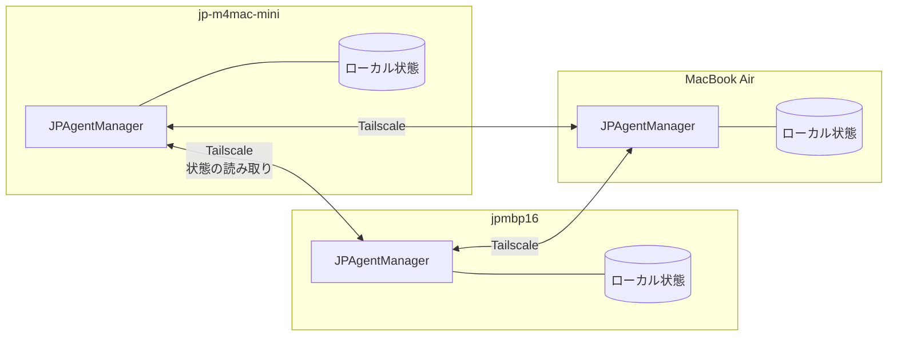

# JPAgentManager 要求仕様

複数の Mac・複数のリポジトリで同時に動かしている Claude Code（主に VSCode 拡張）を、メニューバーから一覧し、クリックでそのセッションの窓を前面に出す macOS アプリ。

- 版: 0.2（2026-10-30）。変更点: 実測を反映。状態は `~/.claude/sessions/<PID>.json` から読み（フックは使わない）、前面化は窓までに下げ、対応 OS を macOS 26 以上に確定
- 初版: 0.1（2026-10-30）
- 関連: [設計メモ.md](設計メモ.md)（形態の検討経緯・実測メモ）、[図/案1-メニューバー.svg](図/案1-メニューバー.svg)

---

## 1. 背景と目的

いくつかの Mac で、同じリポジトリや別々のリポジトリに Claude Code を並行して走らせていると、どこで何をやらせているのか分からなくなる。とくに困るのは次の3つ。

- **許可待ちの放置**: どこかのタブが許可を待って止まっているのに気づかない
- **目的の見失い**: タブがたくさん開いていて、それぞれ何のために開いたのか思い出せない
- **探す手間**: 目的のセッションがどのウィンドウのどのタブにあるのか探すのに時間がかかる

JPAgentManager は、**全マシン・全リポジトリの Claude Code セッションを1か所で見せ、目の前の Mac のものはクリック1回で窓を前面に出す**ことでこれを解消する。

## 2. 用語

| 用語 | 意味 |
|---|---|
| セッション | Claude Code の会話1本。`session_id` で識別する |
| タブ | VSCode 拡張で開いている Claude Code の画面1つ。実体は `claude` プロセス1本 |
| ローカル | 今操作している Mac |
| ピア | 同じアプリが動いている、ほかの Mac |
| 目標 | セッションのタイトル（Claude Code が会話から自動で付ける `ai-title`） |
| 直近の作業 | セッションが最後に行ったツール操作（例: `Edit src/a.ts`） |
| 前面化 | 該当する VSCode ウィンドウを前に出すこと（タブの選択まではしない） |

## 3. 範囲と段階

| 段階 | 内容 |
|---|---|
| **P1: 1台で完結** | ローカルのセッションの一覧・状態・通知・前面化 |
| **P2: マシン横断** | ピアのセッションも同じ一覧に出す。同じリポジトリを複数台で触っている状態を見せる |

P1 だけで単体で役に立つこと。P2 は P1 の上に足す形にし、P1 の作りをやり直さない。

**対象外**（やらない）
- ブラウザ・iPhone からの閲覧（必要になったら AgentNest 側で考える）
- セッションへの指示の送信や、許可・拒否の代行（見るのと前に出すだけ）
- CLI（ターミナル）で動かしている Claude Code の前面化。一覧には出すが、前面化は VSCode 拡張のセッションに限る
- LLM を使った要約

---

## 4. 機能要求

優先度: **M** = 必須、**S** = あるべき、**C** = あれば

### 4.1 一覧（P1）

| ID | 要求 | 優先度 |
|---|---|---|
| FR-101 | メニューバーにアイコンを常駐させ、許可待ちの数・実行中の数・開いているタブ数を表示する | M |
| FR-102 | クリックでドロップダウンを開き、セッションを**リポジトリ単位でまとめて**一覧する | M |
| FR-103 | リポジトリ見出しに、開いているタブ数と、タブごとの状態の点を出す | M |
| FR-104 | 1セッション1行。目標（太字）、状態、経過時間、直近の作業を出す | M |
| FR-105 | 許可待ちの行は、最後に送った指示も出す（何を許可するか判断できるように） | S |
| FR-106 | 並び順は、許可待ちを含むリポジトリ → 実行中 → 待機。リポジトリ内も同じ順 | M |
| FR-107 | 待機だけのリポジトリは折りたたまず通常の大きさで出し、末尾で1枚の少し暗いグレーの背景にまとめ、右肩に「待機中のみ」と出す。「待機中を隠す」で非表示にもできる | S |
| FR-108 | まだ指示を受けていないタブは「空のタブ」として数に含め、行は薄く出す | S |
| FR-109 | タブを閉じたら、10秒以内に一覧から消える | M |
| FR-110 | ドロップダウンは上端のグリップを掴んで動かすと切り離せる。切り離したウィンドウは外のクリック・Esc・行のクリックでは閉じず、× で閉じる。閉じると次はドロップダウンに戻る。アイコンのクリックで最前面に出す。「常に手前」はピンで切り替えられ、選んだ値を覚える（既定オン） | S |
| FR-111 | 実行中→待機（作業完了）に変わったセッションは「未確認の完了」として、行を地味なグレーで塗り「✓ 完了」と出す。行（または完了通知）をクリックするまで残し、実行中に戻ったとき・タブを閉じたときにも消す。並び順は変えず、そのリポジトリは待機のグループに入れない。メニューバーにも 1 件以上あるときだけグレーの点と件数を出す。アプリを再起動すると消える | S |
| FR-112 | フォルダの耳の右に、ブランチ名・プルが必要なコミット数（↓）・未プッシュのコミット数（↑）・変更ファイル数（✎）を出す。開いているリポジトリを 5 分ごとに `git fetch` し、ローカルの状態は 30 秒ごとに読む。fetch に失敗したら印を出し、15 分後に再試行する。認証の入力は求めない | S |

### 4.2 状態

| 状態 | 意味 | 判定 |
|---|---|---|
| 🔴 許可待ち・入力待ち（朱） | ユーザーの操作を待って止まっている（許可待ち＝`permission prompt`、入力待ち＝`input needed`。AskUserQuestion の回答待ちなど） | sessions ファイルの `status` が `waiting` |
| 🟢 実行中 | 指示を受けて作業している | `status` が `busy` |
| ⚪ 待機 | 返答を終えて次の指示を待っている | `status` が `idle`（会話ログに指示がある） |
| ◌ 空 | タブはあるが、まだ指示がない | `status` が `idle` で、会話ログに指示が無い |

| ID | 要求 | 優先度 |
|---|---|---|
| FR-201 | 状態の変化は2秒以内に一覧へ反映する | M |
| FR-202 | 許可待ち（入力待ちを含む）に変わったら macOS 通知を出す。通知のクリックで前面化する | M |
| FR-203 | 実行中→待機（作業完了）の通知は設定で ON/OFF できる（既定 OFF） | C |
| FR-204 | 許可待ち（入力待ちを含む）が一定時間（既定5分）続いたら、メニューバーのアイコンを強調する | C |

### 4.3 前面化（P1）

| ID | 要求 | 優先度 |
|---|---|---|
| FR-301 | 行をクリックすると、そのセッションの VSCode ウィンドウを前面に出す | M |
| FR-302 | 手順は `code <作業フォルダ>` を実行してウィンドウを前面へ（`code` は PATH に無いので `/Applications/Visual Studio Code.app/Contents/Resources/app/bin/code` を直接呼ぶ）。タブの選択まではしない。`vscode://anthropic.claude-code/open?session=<id>` は既存のタブを表示せず、同じ会話の新しいタブを作って「別の場所でも開いている」警告が出る（実測）ため使わない | M |
| FR-303 | 前面化できなかったとき（ウィンドウがない、セッションが見つからない等）は理由を表示し、何もしないか、フォルダを開くだけにとどめる | S |
| FR-304 | 同じフォルダを2つのウィンドウで開いている場合の前面化 | 対象外 |

### 4.4 マシン横断（P2）

#### 4.4.1 構成

各 Mac で同じアプリを動かし、**対等に状態を見せ合う**（中央サーバは置かない）。

中央サーバを置かない理由: どの Mac が寝ていても残りで動くこと、常時起動のマシンを前提にしないこと。

#### 4.4.2 要求

| ID | 要求 | 優先度 |
|---|---|---|
| FR-401 | 各アプリは、自分のローカル状態を読み取り専用の API で公開する | M |
| FR-402 | API は **Tailscale のインターフェースだけ**で待ち受ける。LAN やインターネットには出さない | M |
| FR-403 | ピアは設定で列挙する（Tailscale のホスト名）。`tailscale status` からの自動検出は任意 | M / C |
| FR-404 | ピアの状態は5秒以内に反映する（ポーリング、または変化の通知を受ける） | M |
| FR-405 | 一覧には「マシン別」と「リポジトリ別」の2つの表示を用意し、切り替えられる | M |
| FR-406 | **リポジトリ別**表示では、同じリポジトリを複数台で開いていればまとめて出す。同じかどうかはフォルダ名ではなく git の `origin` URL で判定する（フォルダの場所が Mac ごとに違ってもまとまるように） | M |
| FR-407 | 同じリポジトリの同じブランチで、2台以上が同時に実行中のときは警告を出す（push の衝突やファイルの上書きを防ぐため） | S |
| FR-408 | ピアの行にはマシン名を出す。ローカルの行と見分けがつくようにする | M |
| FR-409 | ピアの許可待ちも通知する。マシンごとに ON/OFF できる | S |
| FR-410 | ピアに届かないときは「オフライン（最終取得 10:30）」と出し、最後に取れた状態を薄く表示する | M |
| FR-411 | ピアの行をクリックしたときの既定動作は詳細表示（目標・直近の作業・指示・作業フォルダ・ブランチ） | M |
| FR-412 | 設定で許可したピアに限り、「そのMacで前面化」を送れる（隣に並べた Mac 向け）。既定 OFF | C |
| FR-413 | メニューバーの数字は、全マシンの合計とローカルだけのどちらを出すか選べる | S |

#### 4.4.3 公開する情報

| 項目 | 公開 | 備考 |
|---|---|---|
| マシン名・session_id・状態・経過時間 | する | — |
| 作業フォルダ・git の origin URL・ブランチ | する | リポジトリ別のまとめと FR-407 に必要 |
| 目標（ai-title）・直近の作業 | する | — |
| 最後の指示（last-prompt） | 設定次第 | 既定は先頭80文字まで。全文は送らない |
| 会話本文・ツールの結果 | **しない** | — |

---

## 5. データの取得元

リモートのコミット差（FR-112）以外は、すべて手元の Mac の中で取れる。外部サービスと LLM は使わない。以下は 2026-10-30 に VSCode 拡張 v2.1.311 で実測した。いずれも読むだけ。

| 表示 | 取得元 |
|---|---|
| 状態 | `~/.claude/sessions/<PID>.json` の `status`（`busy` / `idle` / `waiting`）と `waitingFor`。1セッション1ファイルで、ファイル名は `claude` の PID。ほかに `sessionId`・`cwd`・`entrypoint`・`name`・`statusUpdatedAt`・`startedAt`・`procStart` が入る。状態の変化は1秒以内に書き換わる（上書き） |
| 目標 | 会話ログ（`~/.claude/projects/<パスを-でつないだ名前>/<sessionId>.jsonl`）の `ai-title` 行の `aiTitle`。会話が進むと更新される |
| 最後の指示 | ログの `last-prompt` 行の `lastPrompt` |
| 直近の作業 | ログの最後の `assistant` 行にある `tool_use` の名前と入力（ファイル名・コマンド） |
| タブ数・生存 | sessions ファイルの数。死んだ PID のファイルが残ることがあるので、PID の生存を確かめて除く（`procStart` で PID の使い回しも見分ける）。アプリより前から開いていたタブも載る |
| ブランチ・origin | 作業フォルダで `git` を実行して取る |
| コミット差・変更ファイル数 | `git status --porcelain=v2 --branch` で取る（index.lock を作らない）。リモートの最新は `git fetch` で取る（FR-112） |

**プロセスとセッションの対応づけ**: sessions ファイルのファイル名が PID で、中に `sessionId` と `cwd` が入っているので、対応づけの仕組みは要らない。PID が消えたら、そのタブは閉じたとみなす。

---

## 6. 非機能要求

| ID | 要求 |
|---|---|
| NFR-01 | **Claude Code を遅くしない**。フックは使わず、Claude Code の処理に割り込まない。読むだけにし、プロセス一覧の確認（libproc）は2秒ごとで CPU 0.25%（実測） |
| NFR-02 | 待機中の CPU 使用率は平均1%未満。ログの読み込みは、変化のあったファイルの末尾だけを読む |
| NFR-03 | Claude Code のログ・設定を書き換えない（例外なし）。`~/.claude/settings.json` も触らない |
| NFR-04 | P1 の外部への通信は、リポジトリの `git fetch`（FR-112、通信先は各リポジトリのリモート）と自動更新（Sparkle）だけ。P2 の通信先はこれに加えて設定したピアだけ |
| NFR-05 | ログの形式が変わって読めない項目があっても、アプリは落ちない。読めない項目は「—」で出す |
| NFR-06 | 対応 OS は macOS 26 以上（パネルに `.glassEffect` を使うため） |
| NFR-07 | ログインと同時に起動する設定を持つ |

## 7. 導入とフックの登録

**フックは使わない**。`~/.claude/settings.json` は書き換えないので、各 Mac で登録する作業は要らない。アプリを入れて起動すれば、`~/.claude/sessions/` を読んで動く。フックを採らなかった理由は設計メモの「検証結果」を参照。

## 8. 制約・未検証の前提

初版の前提 1〜3・5 は 2026-10-30 の実測で解消した。

| # | 前提 | 結果 |
|---|---|---|
| 1 | 窓を前に出せる | 成立。`code <作業フォルダ>` でその窓が前に出る |
| 2 | URI で既存タブを表示できる | **不成立**。新しいタブができ警告が出るので、前面化は窓までに下げた（FR-301 / FR-302） |
| 3 | 同じフォルダの2窓を区別できる | 対象外にした（FR-304） |
| 4 | `ai-title`・`last-prompt`・sessions ファイルは公開仕様ではない。Claude Code の更新で変わりうる | 未解消。読めない項目は「—」、状態が読めなければ「状態不明」と出す（NFR-05）。ログは最初のユーザー発言で代用する |
| 5 | アプリ起動前から開いていたタブの対応づけ | 解消。sessions ファイルに起動前からのタブも載る |

**取れないもの**: VSCode の中でどのタブにフォーカスがあるか。この仕様で「アクティブ」と言うときは「実行中か許可待ち」を指す。

## 9. 将来の検討（今回は要求にしない）

- 長時間止まっているセッションをまとめて閉じる・整理する機能
- 1日の作業ログ（別リポジトリで付けている日々の記録）との連携
- CLI のセッションの前面化（Terminal / iTerm のタブの特定）
