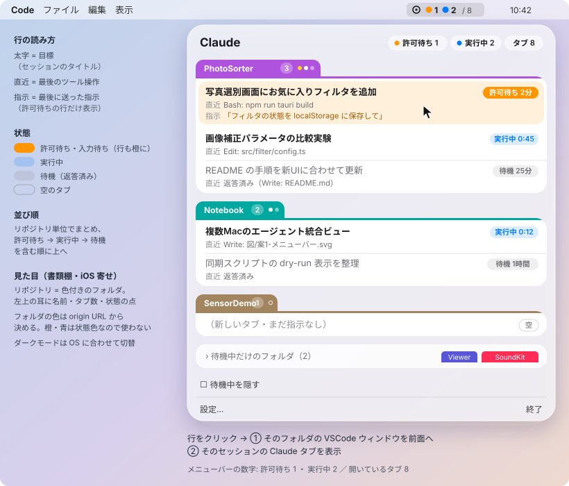
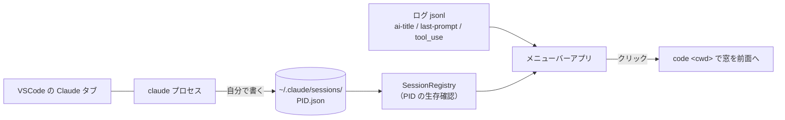

# 設計メモ（形態の検討と実測）

> 別リポジトリの検討メモ（形態比較）から移した（2026-10-30）。要求の正本は [要求仕様.md](要求仕様.md)。

複数のリポジトリで動いている Claude Code（主に VSCode 拡張）の状態をメニューバーから一覧し、クリックでそのセッションの窓を前面に出す Mac アプリ。

- **形態**: メニューバー常駐の Mac アプリに決定（作りは NSStatusItem ＋ NSPanel。「検証結果」参照）。AgentNest 監視タブ案・Web ダッシュボード案は破棄（2026-10-30）
- **範囲**: まず1台で完結させる。マシン横断は後から足す（2026-10-30）

---

## 画面

- **見た目**: 「書類棚」を iOS の作法に寄せた形に決定（2026-10-30）。リポジトリを色付きのフォルダとして描き、左上の耳にリポジトリ名・タブ数・状態の点を載せる。耳は全リポジトリで左に揃える（位置をずらすインデックス風も検討したが、読みやすさを優先）。パネルはすりガラス、フォルダの中は白いカード。状態カプセルは許可待ちだけ塗りつぶし、ほかは色を薄く敷く。フォルダの色は当初 iOS のシステムカラーから origin URL のハッシュで決めていたが、カラフルすぎるので、耳は全リポジトリ共通の藍色（待機グループだけグレー）に変えた（2026-11-05）。状態の色は、許可待ち＝アイコンの背景に近い朱、実行中＝緑、未確認の完了＝地味なグレーで、最も重要な許可待ちを朱に絞る。案の比較は `Docs/図/デザイン案-全体.svg`。ライト／ダークは OS に任せる。管制塔風（ダーク計器盤）・コントロールセンター風も検討したが採らなかった
- **リポジトリ単位でまとめる**: リポジトリ名の横に開いているタブ数と、タブごとの状態の点を出す。「PhotoSorter で何個タブが開いていて、どれが動いているか」が1行目で分かる
- **1タブ＝1行**: 太字が目標（セッションのタイトル）、その下に直近の作業。許可待ちの行だけ、最後に送った指示も出す（何を許可するか判断するため）
- **並び順**: 許可待ちを含むリポジトリ → 実行中 → 待機の順。待機だけのリポジトリは末尾でグレーの背景にまとめる（当初は折りたたみだったが、通常の大きさで見せる形に変更）
- **メニューバーの表示**: 許可待ちの数・実行中の数／開いているタブ数
- **通知**: 許可待ち・入力待ちになった瞬間に macOS 通知。クリックで窓を前面化

---

## 何をどこから取るか

1台の中のファイルとプロセスだけで足りる。外部サービス・LLM 呼び出しは不要。

| 表示 | 取得元 | 実測で確認したこと（2026-10-30, 拡張 v2.1.311） |
|---|---|---|
| 目標 | ログの `ai-title` 行（`aiTitle`） | Claude Code 自身が会話から付けるタイトル。会話が進むと更新される |
| 指示 | ログの `last-prompt` 行（`lastPrompt`） | 最後に送った指示の全文 |
| 直近の作業 | ログの最後の `assistant` 行の `tool_use` | ツール名＋対象（ファイル名・コマンド）を短く整形する |
| 状態 | `~/.claude/sessions/<PID>.json`（下表） | Claude Code が自分で書く。変化は1秒以内に反映 |
| タブ数・生存 | sessions ファイルの数＋PID の生存確認 | 1セッション1ファイル。起動前からのタブも載る。死んだ PID のファイルが残ることがある |

ログの場所は `~/.claude/projects/<パスを-でつないだ名前>/<sessionId>.jsonl`。sessions ファイルの `cwd` と `sessionId` から組み立てる。

### 状態の決め方（sessions ファイル）

| `status` | `waitingFor` | 状態 |
|---|---|---|
| `busy` | — | 🔵 実行中 |
| `waiting` | `permission prompt` | 🟠 許可待ち |
| `waiting` | `input needed` | 🟠 入力待ち（AskUserQuestion の回答待ちなど） |
| `idle` | — | ⚪ 待機。会話ログに指示が無ければ ◌ 空 |
| （ファイルが消えた／PID が死んだ） | — | 一覧から消す |

項目は `pid`・`sessionId`・`cwd`・`entrypoint`（`claude-vscode` など）・`kind`・`name`・`status`・`waitingFor`・`statusUpdatedAt`・`startedAt`・`procStart`（UTC）。ファイルは置き換えでなく上書きなので、読むときは途中の状態を考える。読めなければ「状態不明」。

### プロセスとセッションの対応づけ

ファイル名が PID で、中に `sessionId` と `cwd` が入っているので、対応づけの仕組みは要らない。

---

## 検証結果（2026-10-30）

Claude Code VSCode 拡張 v2.1.311 で実測した。

### 1. 状態の取得元は sessions ファイル

`~/.claude/sessions/<PID>.json` を読む（読むだけ）。項目と状態の対応は上の「状態の決め方」。状態の変化は1秒以内に書き換わる。新しいタブは開いた時点でファイルができる。ファイルは上書きで、死んだ PID のものが残ることがあるので生存を確かめる。公開仕様ではない（`ai-title` と同じ扱い）。

### 2. フックは採らなかった

| 場面 | 来たフック | 分かったこと |
|---|---|---|
| 許可待ち | `Notification`（`notification_type: permission_prompt`） | 通知は来る |
| 許可した後 | `PostToolUse` → `Stop` | 実行中に戻れる |
| 拒否した後 | 何も来ない | フックだけだと許可待ちが残る |
| 60秒放置 | 通知は来なかった | 待機のままの入力待ちは拾えない |
| 親のたどり方 | フック → bash → claude → `Code Helper (Plugin)` | PID は取れる |

ユーザー設定が `defaultMode: auto` のため、許可を求められたのは `git commit` などに限られた。拒否後の取りこぼしがあり、各 Mac の `~/.claude/settings.json` を書き換える必要もあるので、フックは使わない。

### 3. 前面化は窓まで

- `/Applications/Visual Studio Code.app/Contents/Resources/app/bin/code <作業フォルダ>` でその窓は前に出る。`code` は PATH に無い
- ただし `code` CLI は Electron を Node として起動し、さらに GUI の2つ目のインスタンスを起動して既存の窓へ引数を渡すため、毎回約 1.1 秒かかる。`open -b com.microsoft.VSCode <作業フォルダ>` なら新しいプロセスを立てず約 0.1 秒で同じ窓が前に出て、窓も増えない（2026-11-09 実測）。前面化はこちらに切り替えた
- `vscode://anthropic.claude-code/open?session=<id>` は既存のタブを表示せず、同じ会話の新しいタブを作り、「別の場所でも開いている」警告が出る。URI は使わない（ユーザー決定）
- 同じフォルダの2窓は対象外

### 4. メニューバーは NSStatusItem ＋ NSPanel

SwiftUI の `MenuBarExtra` ではなく、`NSStatusItem`（カラー画像）と `NSPanel`（`.glassEffect`）で作った。対応 OS は macOS 26 以上。

### 5. プロセス一覧の負荷

libproc で `claude` を数えて CPU 0.25%（2秒ごと）。

---

## 取れないもの・未検証の前提

- **VSCode の中でどのタブにフォーカスがあるか**は外から見えない。この資料の「アクティブ」は「実行中か許可待ち」の意味
- 同じフォルダを2ウィンドウで開いているとき、正しいほうを前に出す手段は無い（対象外）
- タブを指定して表示する手段は無い（窓までに下げた）
- `ai-title`・`last-prompt`・sessions ファイルはどれも内部形式で、公開仕様ではない。Claude Code の更新で変わりうる
